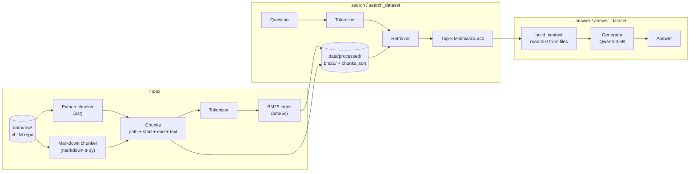
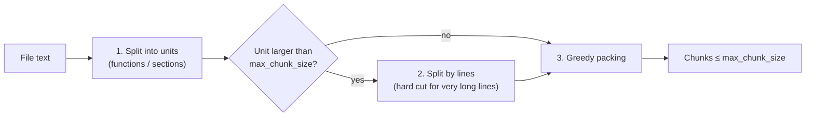
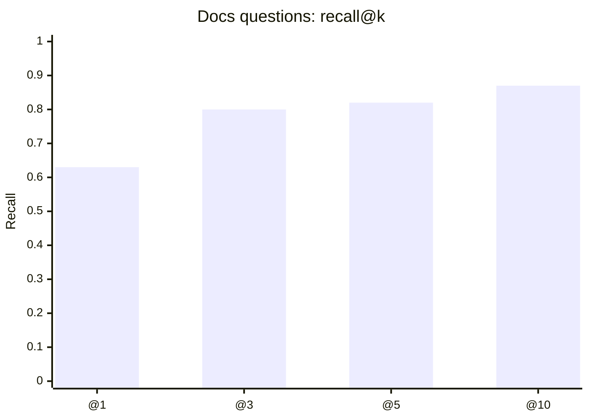
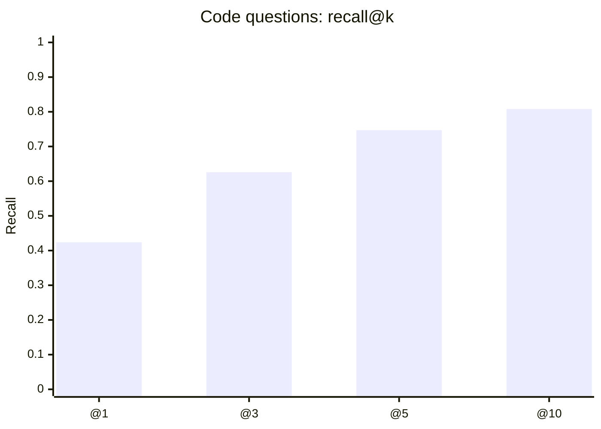
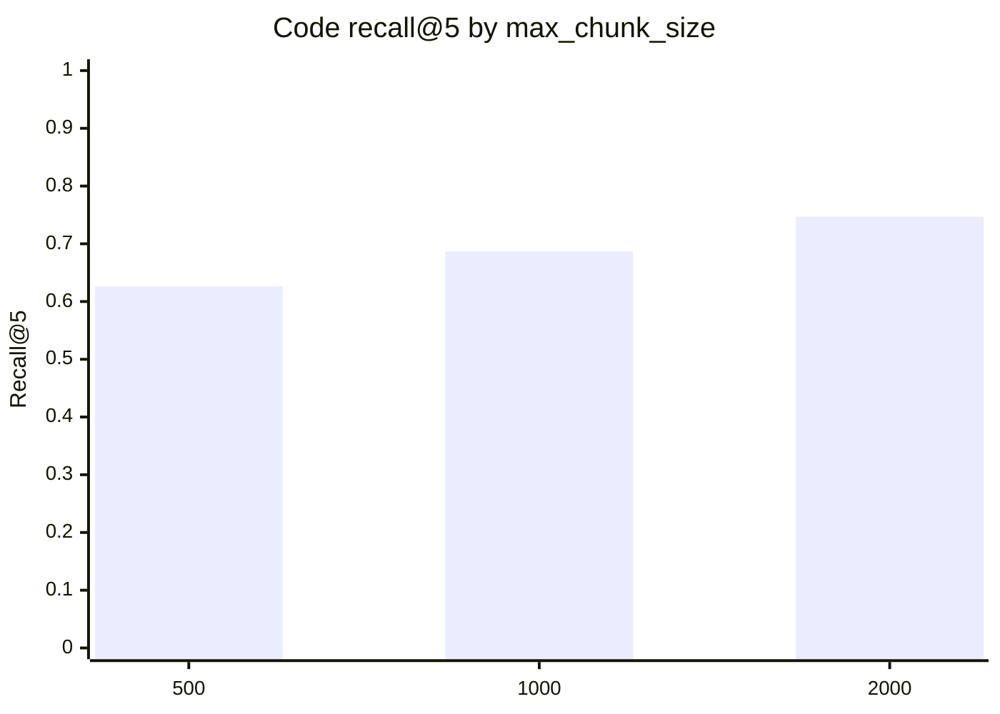

*This project has been created as part of the 42 curriculum by lunsold.*

# RAG against the machine

> Ask a question about the vLLM codebase, get back the exact source locations and a grounded answer from a small local model.


---

## Table of Contents

- [Description](#description)
- [Instructions](#instructions)
- [Example usage](#example-usage)
- [System architecture](#system-architecture)
- [Chunking strategy](#chunking-strategy)
- [Retrieval method](#retrieval-method)
- [Performance analysis](#performance-analysis)
- [Design decisions](#design-decisions)
- [Challenges faced](#challenges-faced)
- [Project structure](#project-structure)
- [Resources](#resources)

---

## Description

A language model only knows what it saw during training. Ask it about a specific codebase and it will either refuse or confidently invent an answer. **Retrieval-Augmented Generation (RAG)** solves this without retraining: at question time, the system looks up the relevant pieces of the codebase and hands them to the model as context.

This project implements a complete RAG pipeline over the **vLLM 0.10.1** repository:

| Stage | What it does in this project |
|---|---|
| **Indexing** | Splits every `.py`, `.md` and `.txt` file into chunks of at most 2000 characters and builds a BM25 index |
| **Retrieving** | Finds the top-k chunks for a question and returns their exact `file_path` and character range |
| **Augmenting** | Reads the text of the best chunks and places it in the model's context window |
| **Generating** | Lets **Qwen/Qwen3-0.6B** write an answer that is grounded in those chunks |

Retrieval quality is measured with **recall@k**. On the public datasets the system reaches **82 % recall@5 on documentation questions** and **75 % recall@5 on code questions** (required: 80 % and 50 %).

---

## Instructions

### Requirements

- Python **3.14**
- [uv](https://docs.astral.sh/uv/) as package manager
- A few GB of free disk space (PyTorch + model weights)
- The vLLM repository placed under `data/raw/vllm-0.10.1/`

### Installation

```bash
git clone https://github.com/Luisdergoat/RAG-against-the-machine.git
cd RAG-against-the-machine
uv sync
```

On the first `answer` call, the Qwen3-0.6B weights (~1.2 GB) are downloaded from Hugging Face automatically.

### Running the full pipeline

**1. Build the index** (once, or after changing the chunking or tokenizer)

```bash
uv run python3 src index --max_chunk_size 2000
```

**2. Search a whole dataset**

```bash
uv run python3 src search_dataset --dataset_path data/datasets/UnansweredQuestions/dataset_docs_public.json --k 10 --save_directory data/output/search_results/UnansweredQuestions
```

```bash
uv run python3 src search_dataset --dataset_path data/datasets/UnansweredQuestions/dataset_code_public.json --k 10 --save_directory data/output/search_results/UnansweredQuestions
```

**3. Evaluate your own recall@k**

```bash
uv run python3 src evaluate --student_answer_path data/output/search_results/UnansweredQuestions/dataset_docs_public.json --solution_path data/datasets/AnsweredQuestions/dataset_docs_public.json
```

```bash
uv run python3 src evaluate --student_answer_path data/output/search_results/UnansweredQuestions/dataset_code_public.json --solution_path data/datasets/AnsweredQuestions/dataset_code_public.json
```

**4. Generate answers for a dataset**

```bash
uv run python3 src answer_dataset --student_search_results data/output/search_results/UnansweredQuestions/dataset_docs_public.json --save_directory data/output/search_results_and_answer/UnansweredQuestions
```

### Single queries

```bash
uv run python3 src search "How do I enable LoRA adapters?" --k 5
```

```bash
uv run python3 src answer "What activation formats does the fused batched MoE layer return in vLLM?" --k 5
```

### Makefile

| Rule | What it does |
|---|---|
| `make install` | Installs all dependencies with `uv sync` |
| `make run ARGS='...'` | Runs the program, e.g. `make run ARGS='search "lora" --k 3'` |
| `make debug ARGS='...'` | Runs the program inside `pdb` |
| `make lint` | Runs `flake8` and `mypy` |
| `make lint-strict` | Runs `flake8` and `mypy --strict` |
| `make clean` | Removes `__pycache__`, `.mypy_cache`, `.pytest_cache` |

> **Note:** Pass arguments through `ARGS='...'`. Without it, `make` drops the quotes around the question and interprets `--k` as its own option.

```bash
make run ARGS='answer "What activation formats does the fused batched MoE layer return in vLLM?" --k 5'
```

---

## Example usage

**Search**

```console
$ uv run python3 src search "What activation formats does the fused batched MoE layer return in vLLM?" --k 3
{
  "file_path": "data/raw/vllm-0.10.1/vllm/model_executor/layers/fused_moe/cutlass_moe.py",
  "first_character_index": 23564,
  "last_character_index": 25507
}
...
```

**Search a dataset**

```console
$ uv run python3 src search_dataset --dataset_path data/datasets/UnansweredQuestions/dataset_docs_public.json --k 10 --save_directory data/output/search_results/UnansweredQuestions
Searching dataset: 100%|██████████| 100/100 [00:00<00:00, ...]
Saved student_search_results to data/output/search_results/UnansweredQuestions/dataset_docs_public.json
```

**Evaluate**

```console
$ uv run python3 src evaluate --student_search_results_path data/output/search_results/UnansweredQuestions/dataset_docs_public.json --dataset_path data/datasets/AnsweredQuestions/dataset_docs_public.json
Evaluated 100 questions
Recall@1: 0.630  Recall@3: 0.800  Recall@5: 0.820  Recall@10: 0.870
```

**Output format** (`StudentSearchResults`)

```json
{
  "search_results": [
    {
      "question_id": "189c8b8a-e59c-4fca-92ad-c02df42cbe40",
      "question": "What activation formats does the fused batched MoE layer return in vLLM?",
      "retrieved_sources": [
        {
          "file_path": "data/raw/vllm-0.10.1/vllm/model_executor/layers/fused_moe/fused_batched_moe.py",
          "first_character_index": 26827,
          "last_character_index": 28790
        }
      ]
    }
  ],
  "k": 10
}
```

---

## System architecture



| Component | File | Responsibility |
|---|---|---|
| **CLI** | `src/__main__.py` | Python Fire entry point, orchestrates all commands, recall@k evaluation |
| **Python chunker** | `src/python_indexing.py` | Splits Python files along functions and classes; shared helpers `line_starts`, `pack_units`, `split_by_lines`, `split_oversized` |
| **Markdown chunker** | `src/markdown_indexing.py` | Splits Markdown and text files along headings |
| **Tokenizer** | `src/tokenizer.py` | Turns any text into lowercase tokens, splits `snake_case` and `CamelCase` |
| **Retriever** | `src/retriever.py` | Loads the BM25 index and the chunk list once, returns top-k sources |
| **Generator** | `src/generator.py` | Loads Qwen once, builds the prompt, generates the answer |
| **Data models** | `src/models.py` | pydantic models exchanged between all stages |

The retriever and the generator are separate on purpose: `search` and `search_dataset` never load the language model, so they stay fast.

---

## Chunking strategy

Every chunk is stored as a **position**, not just as text: `file_path`, `first_character_index`, `last_character_index`. The text is never modified before the positions are computed, so `file_text[start:end] == chunk.text` always holds.

All chunkers follow the same three-step pipeline. Only step 1 differs between file types.



### Step 1a: Python files (`ast`)

The file is parsed with Python's built-in `ast` module. Each top-level node (import, assignment, function, class) starts a new **unit**. A unit always runs from the start of its node to the start of the next node, so blank lines and comments are never lost. Decorators are attached to the function they belong to.

```text
Unit 1   import os                ┐
                                  ┘  0 – 11
Unit 2   X = 5                    ┐
                                  ┘  11 – 18
Unit 3   @decorator               ┐
         def foo(a, b):           │
             ...                  ┘  18 – 93
Unit 4   class Bar:               ┐
             ...                  ┘  93 – 140
```

If a file cannot be parsed (`SyntaxError`), it falls back to a single unit that is then split by lines.

### Step 1b: Markdown and text files (`markdown-it-py`)

Every heading (`#`, `##`, ...) starts a new unit. `markdown-it-py` is used instead of a simple `startswith("#")` check because it knows about code blocks: a `# comment` inside a bash block is **not** treated as a heading. Files without any heading become one unit.

### Step 2: Oversized units

Some functions and classes in vLLM are far larger than 2000 characters. Such units are split at line boundaries. A single line longer than `max_chunk_size` is cut into pieces of exactly `max_chunk_size` characters.

### Step 3: Greedy packing

Neighbouring units are merged as long as the result still fits into `max_chunk_size`. Small units (imports, constants, short sections) end up together, large ones stay alone.

```text
units:   [ 300 ] [ 800 ] [ 600 ] [ 2500 ] [ 800 ]
                                     │
                        split by lines (step 2)
                                     ▼
chunks:  [ 300 + 800 + 600 ] [ 1950 ] [ 550 + 800 ]
               1700            1950       1350
```

Result for the full corpus: **12 935 chunks**, none longer than 2000 characters.

---

## Retrieval method

### Tokenizer

Questions and source code rarely use the same words. A question says *"max num seqs"*, the code says `max_num_seqs`. The tokenizer bridges that gap and is applied identically to chunks and questions:

| Input | Tokens |
|---|---|
| `What activation formats?` | `what`, `activation`, `formats` |
| `max_num_seqs` | `max_num_seqs`, `max`, `num`, `seqs` |
| `LoRAConfig` | `loraconfig`, `lo`, `ra`, `config` |
| `get_LoRAConfig` | `get_loraconfig`, `get`, `loraconfig`, `lo`, `ra`, `config` |
| `__init__` | `__init__`, `init` |

1. Extract words with `[A-Za-z0-9_]+`
2. Split at underscores, keep the full identifier as well
3. Split `CamelCase` with `[A-Z]+(?=[A-Z][a-z])|[A-Z]?[a-z]+|[A-Z]+|[0-9]+`, so that acronyms stay together (`HTTPServer` → `HTTP`, `Server`)
4. Lowercase everything

The full identifier is kept next to its parts. A chunk that contains `max_num_seqs` verbatim gets an extra match when the question quotes it exactly.

### BM25

Ranking uses **Okapi BM25** (implementation: [`bm25s`](https://github.com/xhluca/bm25s), Lucene variant, `k1 = 1.5`, `b = 0.75`). For a question $Q$ with terms $q_1 \dots q_n$ and a chunk $D$:

$$
\text{score}(D, Q) = \sum_{i=1}^{n} \text{IDF}(q_i) \cdot \frac{f(q_i, D) \cdot (k_1 + 1)}{f(q_i, D) + k_1 \cdot \left(1 - b + b \cdot \frac{|D|}{\text{avgdl}}\right)}
$$

In plain words:

| Factor | Meaning |
|---|---|
| $f(q_i, D)$ | A question word that appears in the chunk earns points, repeated occurrences earn more, with diminishing returns ($k_1$) |
| $\text{IDF}(q_i)$ | Rare words count more than common ones. `seqs` is a strong signal, `the` is almost worthless |
| $\frac{\lvert D \rvert}{\text{avgdl}}$ | Long chunks get a small penalty so they don't win just by containing many words ($b$) |

BM25 only knows chunks by their position in the list it was built from. `chunks.json` is saved in exactly the same order, so result number `n` maps directly to `chunks[n]`.

### Answer generation

The generator receives the top 5 sources of each question. Their text is read from the original files and labelled with their path:

```text
[Source 1: data/raw/vllm-0.10.1/vllm/.../fused_batched_moe.py]
@property
def activation_formats(self) -> tuple[...]:
    return (mk.FusedMoEActivationFormat.BatchedExperts, ...)

[Source 2: ...]
```

The system prompt tells the model to answer **only** from that context, to say so if the answer is missing, and not to retell the code. Qwen3's thinking mode is disabled (`enable_thinking=False`) so the answer is short and does not contain a `<think>` block.

---

## Performance analysis

All numbers were measured on the public datasets (100 docs questions, 99 code questions). A source counts as found when a result is in the same file and overlaps the reference span with an IoU of at least 0.05.

### Recall@k (`max_chunk_size = 2000`)

| Dataset | Recall@1 | Recall@3 | **Recall@5** | Recall@10 | Required @5 |
|---|---|---|---|---|---|
| Docs | 0.630 | 0.800 | **0.820** ✅ | 0.870 | 0.80 |
| Code | 0.424 | 0.626 | **0.747** ✅ | 0.808 | 0.50 |





### Effect of the chunk size

| `max_chunk_size` | Chunks | Docs @5 | Code @5 | Docs @10 | Code @10 |
|---|---|---|---|---|---|
| **2000** (default) | 12 935 | **0.820** | **0.747** | **0.870** | **0.808** |
| 1000 | 24 392 | 0.810 | 0.687 | 0.870 | 0.758 |
| 500 | 47 048 | 0.780 | 0.626 | 0.830 | 0.758 |



Smaller chunks hurt, especially for code. A code question usually needs the whole function: with small chunks, the signature, the docstring and the body end up in different chunks and none of them alone contains enough of the question's words. The default of 2000 characters gives the best recall.

### Speed

| Operation | Limit | Measured |
|---|---|---|
| Indexing the full corpus | 5 min | ~18 s |
| Retrieval, 200 questions (excluding index loading) | 90 s | < 0.1 s |
| Answer generation | — | several seconds per question on CPU |

---

## Design decisions

| Decision | Why |
|---|---|
| **BM25 instead of TF-IDF** | BM25 saturates term frequency and normalises for chunk length. Both matter here because chunk sizes vary a lot between a short constant block and a 2000-character class |
| **`bm25s` library** | Fast, can save and load the index, accepts pre-tokenized input so the custom tokenizer can be used |
| **Store positions, cut text at the end** | The grader only compares `file_path` and character ranges. Keeping `(start, end)` everywhere and slicing the text last makes it impossible for indices and text to drift apart |
| **Relative paths** | Paths are stored as `data/raw/vllm-0.10.1/...` exactly as the grader expects. `project_root` is only prepended when a file has to be opened |
| **One shared packing pipeline** | `pack_units`, `split_by_lines` and `split_oversized` only work with `(start, end)` pairs and don't know the file type. Python and Markdown only differ in how units are found |
| **`markdown-it-py` for headings** | Correctly ignores `#` inside code blocks, which are very common in the vLLM docs |
| **Only `.py`, `.md`, `.txt`** | All reference sources in the public datasets are in these file types. Indexing `.json`, `.cu`, `.yaml` etc. would only add noise |
| **Keeping `tests/` in the index** | Tested with and without the `tests/` folder: docs @5 stayed at 0.820, code @5 went from 0.747 to 0.737. No clear gain, so the corpus stays complete |
| **Retriever and generator separated** | Search commands never load the 1.2 GB model, answer commands load it exactly once |
| **Only 5 sources in the prompt** | `k = 10` sources would mean roughly 5000–6000 tokens. The small model gets slower and loses focus with that much context |
| **pydantic for all exchanged data** | Inputs are validated on load, so a malformed JSON file produces a clear error instead of a crash deep in the pipeline |

---

## Challenges faced

| Problem | Solution |
|---|---|
| **Character indices.** It was unclear whether whitespace counts and how line numbers from `ast` map to character positions | Every character counts, including `\n`. A list of line start offsets (built with a running sum over `splitlines(keepends=True)`) converts line numbers to character positions in O(1) |
| **Decorators got lost.** `ast` reports the `def` line, not the `@decorator` line above it | Use the line of the first entry in `decorator_list` as the start |
| **Gaps between functions.** Using `end_lineno` dropped blank lines and comments between nodes | A unit always runs to the start of the next node, so units cover the file without gaps |
| **Absolute paths.** The first version stored paths like `/Users/.../data/raw/...`, which would have given 0 % recall | `Path(file_path).relative_to(project_root).as_posix()` |
| **Duplicate tokens.** One-part words like `What` were added twice (as full word and as part), doubling the weight of useless words | Only add the full word when it consists of more than one part |
| **`__` as a token.** `re.split(r"(_+)")` kept the separators, so `__init__` produced `__` tokens | Split without a capturing group: `re.split(r"_+")` |
| **`make run` broke questions.** `make` drops quotes and treats `--k` as its own `--keep-going` option | Pass all arguments through one variable: `make run ARGS='...'` |
| **The model was loaded for every question.** | A dedicated `Generator` class that loads Qwen once |
| **Answers described the code instead of answering.** The question was not passed to the model, and only the last chunk reached the prompt | Collect all chunk texts, label them with their source, put the question after the context in a single user message |

---

## Project structure

```text
RAG-against-the-machine/
├── Makefile
├── README.md
├── pyproject.toml
├── uv.lock
├── src/
│   ├── __init__.py
│   ├── __main__.py           # CLI (Python Fire) + evaluation
│   ├── models.py             # pydantic models
│   ├── python_indexing.py    # Python chunking + shared packing helpers
│   ├── markdown_indexing.py  # Markdown / text chunking
│   ├── tokenizer.py          # tokenizer for BM25
│   ├── retriever.py          # BM25 search
│   └── generator.py          # Qwen answer generation
└── data/
    ├── raw/                  # vLLM repository (not committed)
    ├── processed/            # index created by `index` (not committed)
    ├── datasets/
    │   ├── AnsweredQuestions/
    │   └── UnansweredQuestions/
    └── output/               # search and answer results (not committed)
```

---

## Resources

### References

- Lewis et al., [*Retrieval-Augmented Generation for Knowledge-Intensive NLP Tasks*](https://arxiv.org/abs/2005.11401), 2020. The paper that introduced RAG
- Robertson & Zaragoza, [*The Probabilistic Relevance Framework: BM25 and Beyond*](https://www.staff.city.ac.uk/~sbrp622/papers/foundations_bm25_review.pdf), 2009. Background and derivation of BM25
- Manning, Raghavan & Schütze, [*Introduction to Information Retrieval*](https://nlp.stanford.edu/IR-book/), chapters 6 and 11. TF-IDF, BM25 and evaluation metrics
- [`bm25s` documentation](https://github.com/xhluca/bm25s)
- [Python `ast` module](https://docs.python.org/3/library/ast.html)
- [`markdown-it-py` documentation](https://markdown-it-py.readthedocs.io/)
- [Qwen3-0.6B model card](https://huggingface.co/Qwen/Qwen3-0.6B)
- [Hugging Face Transformers: text generation](https://huggingface.co/docs/transformers/main/en/llm_tutorial)
- [pydantic documentation](https://docs.pydantic.dev/)
- [Python Fire](https://github.com/google/python-fire), [tqdm](https://tqdm.github.io/), [uv](https://docs.astral.sh/uv/)

### Use of AI

Claude (Anthropic) was used throughout the project as a tutor and reviewer, not as a code generator for whole components. Concretely:

- **Understanding concepts:** explanations of RAG, BM25, IoU, recall@k, the `ast` module, regular expressions for `CamelCase` splitting and how chat templates work for Qwen.
- **Planning:** breaking the project into small steps (line offsets → units → packing → oversized units → indexer → tokenizer → BM25 → search → evaluate → answer).
- **Code review and debugging:** finding bugs such as an infinite loop, a `return` inside a loop, absolute file paths, duplicate tokens and a wrong IoU union, and explaining why they happened.
- **Unit tests:** most of the pytest tests for the chunking functions were written with AI help and used to verify my own implementations.
- **Code snippets:** some smaller parts were written with AI assistance and then reviewed and integrated by me, mainly the line splitter, the `evaluate` logic and the `Generator` class.
- **Measurements and documentation:** running the chunk-size comparison and drafting this README.

Every piece of AI-assisted code was read, tested and adapted until I could explain it.
